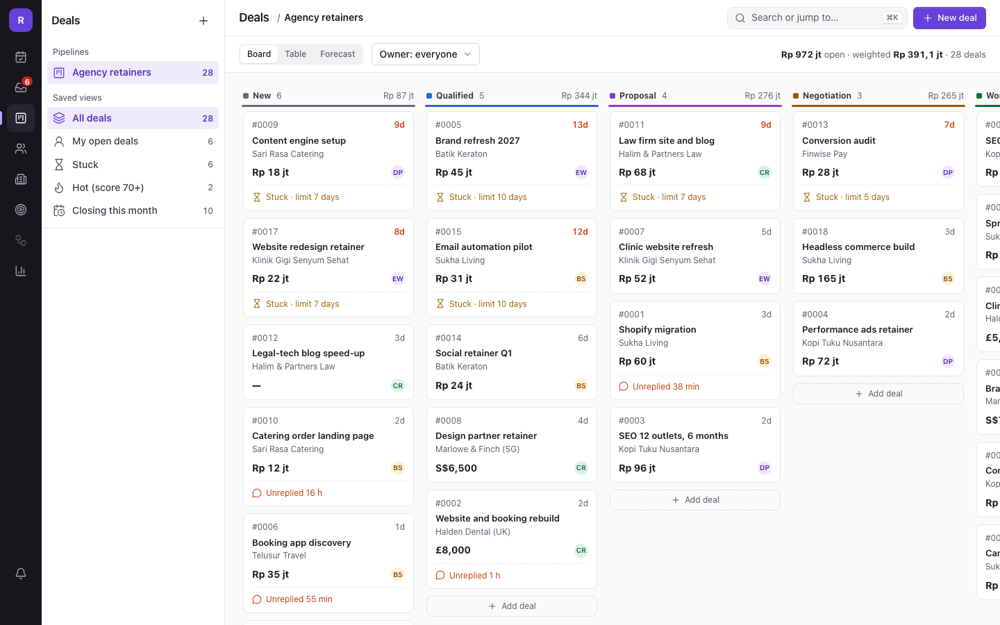
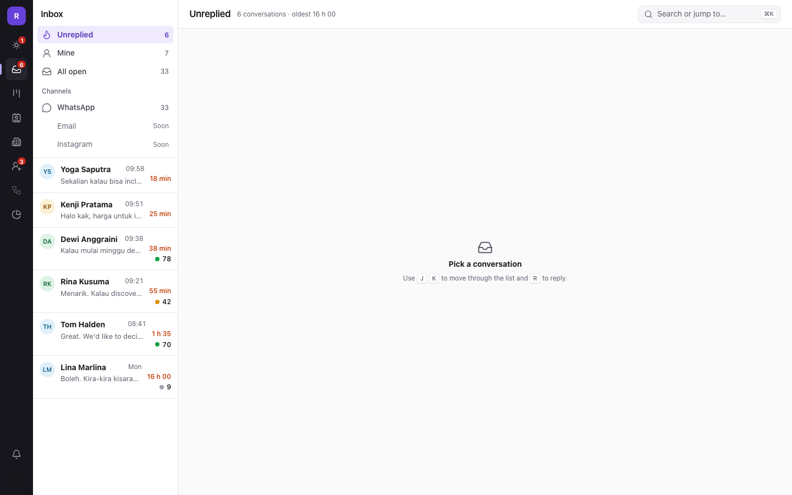
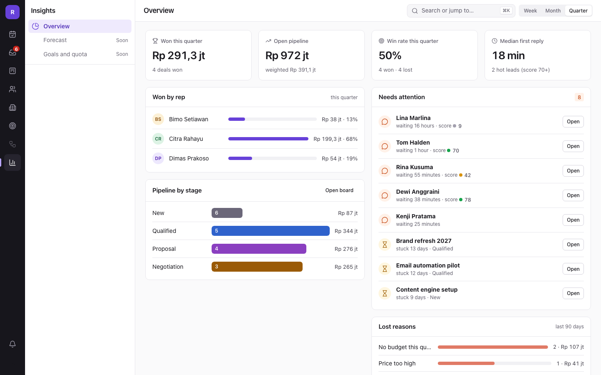
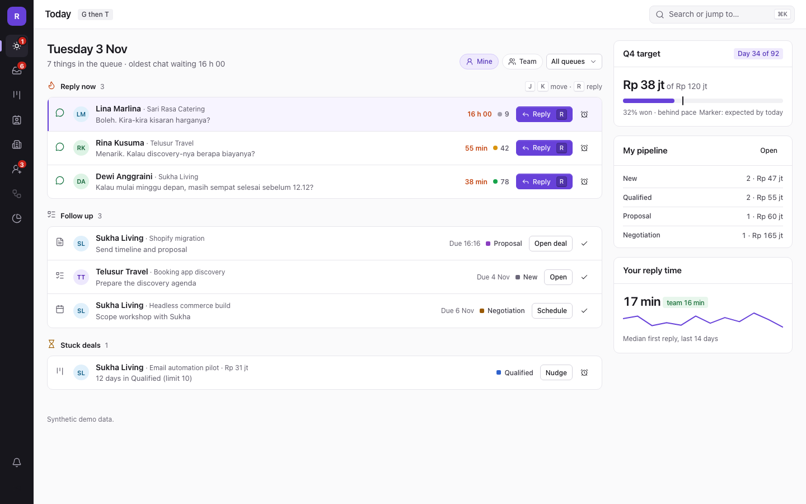

# Relay — Sales CRM with a WhatsApp inbox and explainable AI

Relay is a CRM for small sales teams that sell through conversations, mostly on
WhatsApp. Pipeline deals, contact timelines and the WhatsApp inbox live in one
place: every incoming message attaches to its contact and deal, AI summarizes
long threads **with links to the source messages**, scores leads **with visible
reasons**, and drafts replies that **a human always sends**.

Stack: **Laravel 13 · PostgreSQL · Redis ·
Inertia + Vue 3**. UI is a custom design system ("Relay DS": dark icon rail,
context panel, Geist, keyboard-first).

---

## ⚠️ Honest demo note: WhatsApp runs in simulated mode

The public demo does **not** connect to a real Meta WhatsApp business number
(business verification is not available for a public demo). Instead:

- The number is seeded in `simulated` mode and the `SimulatedClient` channel
  adapter answers locally — no network calls to Meta.
- Inbound messages are produced by the **`POST /dev/simulate-inbound`**
  endpoint (admin only, button on the Inbox screen). It fabricates a Meta-shaped
  webhook payload and runs it through the **exact same** `ProcessWhatsAppEvent`
  job as live traffic: signature-independent ingest, E.164 dedup, round-robin
  assignment, 24-hour window bookkeeping.
- The real integration code is present and used for `live` numbers:
  `App\Services\WhatsApp\CloudApiClient` (Meta Graph API), webhook signature
  verification (`X-Hub-Signature-256`), GET verify handshake, template sending,
  and status callbacks. It is covered by tests with Meta documentation-shaped
  payloads (`tests/Feature/InboxTest.php`).

**To connect a real number:** create a Meta app with the WhatsApp product, put
the app secret + verify token in `.env` (`WHATSAPP_APP_SECRET`,
`WHATSAPP_VERIFY_TOKEN`), point the Meta webhook to `GET/POST /webhooks/whatsapp`,
create the number row in `whatsapp_numbers` with `mode=live` and the encrypted
access token, and switch the queue worker on. Message pricing and the 24-hour
service window follow Meta's current policy; the window length is configurable
via `WHATSAPP_FREEFORM_WINDOW_HOURS`.

Same honesty for the AI: Relay runs on **Groq** (`AI_DRIVER=groq`; `auto` also tries Anthropic).
With a key it uses **Groq** (`GROQ_API_KEY`, `openai/gpt-oss-120b` unless `GROQ_MODEL` says
otherwise), then **Anthropic** (`ANTHROPIC_API_KEY`), and falls back to a
deterministic simulated client that answers with the same JSON contracts, so the
whole summarizing / scoring / drafting pipeline is demonstrable offline. Card and
bank-account numbers are masked (`App\Support\Redactor`) before any text reaches a
model and again before the answer is stored. Every AI run is logged in `ai_runs`
(model, tokens, status) and visible under Settings → AI.

## Features

| # | Feature | Where |
|---|---|---|
| F1 | Multi-company, roles (Admin/Manager/Rep), audit log | `BelongsToCompany` scope, role gates, `owen-it/laravel-auditing` |
| F2 | Contacts & accounts, E.164 phone dedup, merge | Contacts screen, `ContactService` |
| F3 | Pipeline kanban + stale-stage detection, mandatory lost reason | Deals screen, `DealService`, `relay:detect-stale-deals` |
| F4 | Merged timeline per contact & deal (messages, notes, stage changes, AI, tasks) | Deal/Contact detail |
| F5 | WhatsApp inbox: assignment, statuses, 24h window, templates | Inbox screen, `MessageSender` |
| F6 | Sourced AI summaries + next step + reply drafts (never auto-sent) | `ConversationSummarizer`, `ReplyDrafter` |
| F7 | Explainable lead scoring (structured 0–70 + AI −15..+30) with manager override | `LeadScorer`, `score_overrides` |
| F8 | Today work queue: stale deals, unreplied leads (working-hours aware) | `TodayController`, `relay:detect-unreplied` |
| — | Manager dashboard (win rate, weighted pipeline, median first reply, needs attention, lost reasons) | `/insights`, `OverviewController` |
| — | Leads with one-click conversion (dedup-safe contact reuse) | `LeadController` |
| — | ⌘K command palette + global search + G-key navigation | `SearchController`, `CommandPalette.vue` |
| — | CSV contact import with duplicate preview | `ContactImportController` |
| — | Companies with their people, deals and open value | `CompanyAccountController` |
| — | Notification bell (@mentions, new chat assignments) | `NotificationController`, `Mentioned`, `ConversationAssigned` |
| — | Retry for failed outbound WhatsApp messages | `MessageSender::retry` |
| — | Admin editors for pipeline stages (stuck limits, order) and message templates | `SettingsPipelineController` |
| — | Mixed-currency pipeline totals converted at configurable estimates | `Money`, `config/relay.php` |

## Screens & demo

| | |
|---|---|
|  |  |
|  |  |

All screens: [docs/screenshots/](docs/screenshots/) · Walkthrough video: [docs/demo.webm](docs/demo.webm) · Case study: [docs/CASE-STUDY.md](docs/CASE-STUDY.md)

## Running locally

Requirements: PHP 8.3+, Composer, PostgreSQL 16+, Redis, Node 20+.

```bash
cp .env.example .env            # set DB + Redis (see below)
composer install
npm install
php artisan key:generate
php artisan migrate --seed      # seeds "Northwind Studio" demo data
npm run build
php artisan serve               # http://localhost:8000
php artisan queue:work          # separate terminal (webhooks, AI, reminders)
```

### End-to-end test

```bash
# needs a freshly seeded dev DB (the specs create data): php artisan migrate:fresh --seed
npx playwright test             # lead -> AI-drafted reply; deal workflow; @mention bell; settings editors
```

Seeder logins (all passwords `password`; in non-production the sign-in page lists them as one-click shortcuts):

| User | Role |
|---|---|
| ayu@northwind.test | Admin |
| bimo@northwind.test | Manager |
| citra@northwind.test / dimas@ / elena@ | Reps |

Scheduled reminders (`relay:detect-stale-deals`, `relay:detect-unreplied`, every
5 min) run via Laravel's scheduler: `php artisan schedule:work`.

### Environment

```
DB_CONNECTION=pgsql  DB_PORT=5432  DB_DATABASE=relay  DB_USERNAME=...  DB_PASSWORD=...
QUEUE_CONNECTION=redis
WHATSAPP_APP_SECRET=          # empty = signature check skipped (dev)
WHATSAPP_VERIFY_TOKEN=relay-dev-verify
WHATSAPP_FREEFORM_WINDOW_HOURS=24
AI_DRIVER=groq                # groq | auto | anthropic | fake
GROQ_API_KEY=                 # Groq, OpenAI-compatible; GROQ_MODEL defaults to openai/gpt-oss-120b
ANTHROPIC_API_KEY=            # optional alternative; all empty = simulated AI (demo mode)
```

## Testing

```bash
php artisan test          # 75 tests: unit + feature
vendor/bin/phpstan        # level 5, 0 errors
vendor/bin/pint           # code style
```

Key test guarantees: bad webhook signature → 401; duplicate `wamid` stored
once; tenant isolation on every route (foreign data = 404); free-form replies
locked after the 24h window while templates still send; AI summary points
without real `message_ids` are rejected; drafts never send; scores always show
≥3 reasons; manager overrides survive recomputation.

## Architecture notes

- **Tenancy**: every tenant model uses the `BelongsToCompany` trait — a global
  scope bound by the `EnsureCompany` middleware; `company_id` is never mass
  assignable. Console/webhook code stamps it explicitly.
- **WhatsApp**: `MessagingChannel` interface with `CloudApiClient` /
  `SimulatedClient`, chosen per number via `MessagingChannelManager`. Ingest is
  one idempotent queue job shared by live webhooks and the demo simulator.
- **AI**: `AIClient` interface (Groq, Claude or simulated, wrapped by `RedactingAIClient`). The summarizer
  rejects any point whose `message_ids` do not exist in the conversation;
  scoring is deterministic-structured first, AI is a bounded adjustment; every
  run is logged to `ai_runs`.

## Not included yet

Email and Instagram channels, sequences, a forecast view per rep, quote PDFs, a custom-field builder, a report builder, and media upload for live WhatsApp numbers.
